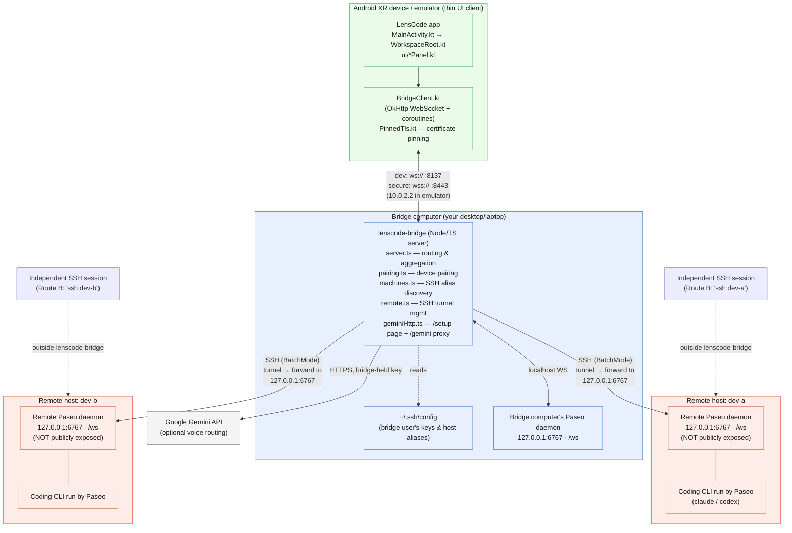

# Architecture: Android XR client, lenscode-bridge, and Paseo

Companion to [Try LensCode](try-it-workflows.md) and [Remote setup and current limits](remote-setup-and-limits.md).

The Android XR client never talks to any Paseo daemon directly. It only
connects to `lenscode-bridge`, which runs on the "bridge computer" (a regular
desktop/laptop, not the glasses/headset) alongside a Paseo daemon.
`lenscode-bridge` holds the bridge user's SSH keys/config and is the only
process that opens SSH tunnels to remote hosts, forwarding to each remote
Paseo daemon's loopback port (`127.0.0.1:6767`). Remote Paseo daemons are
never exposed publicly — the SSH tunnel is the only path to them.

## Key points

- **One hop for the client**: the app/glasses only ever speaks to
  `lenscode-bridge`, never directly to any Paseo daemon.
- **Two connection modes.** Dev mode (`npx lenscode-bridge`) is plain `ws://`
  on port 8137 and open to the local network; only debug builds accept it.
  Secure mode (`npx lenscode-bridge --secure`) is `wss://` on port 8443 with a
  certificate the bridge makes itself. On first contact the app shows the
  certificate's fingerprint, the user checks it against the one the bridge
  printed, and the app pins that certificate. A new headset then pairs with a
  6-digit code printed in the bridge console. Release builds only accept
  secure addresses. A certificate from a public authority (`--tls-cert` /
  `--tls-key`) also works and needs no fingerprint prompt.
- **`lenscode-bridge` is the only process holding SSH credentials** — that's
  why it lives on a desktop, not the headset.
- **The bridge computer is not a "machine" in the app.** The bridge refers to
  its own Paseo daemon as `"local"` internally, but the app's host pickers list
  only SSH hosts from `~/.ssh/config`.
- **Remote Paseo daemons stay on loopback** (`127.0.0.1:6767`) on their own
  hosts; they're reachable only via the SSH tunnel `lenscode-bridge` opens,
  never exposed publicly.
- **The Gemini key stays on the bridge.** It is set on the bridge's `/setup`
  page (or `GEMINI_API_KEY`), and the headset calls Gemini through the bridge's
  `/gemini/*` proxy, which adds the key. In secure mode the page needs the setup
  code the bridge prints, and the proxy needs a paired device.
- **Route B** (dotted lines): a coding CLI started in an independent
  `ssh dev-a`/`dev-b` session runs outside `lenscode-bridge`, which is why
  those sessions don't show up as XR agent cards.

## Implementation references

- [Window setup](../client-android/app/src/main/java/com/lenscode/app/MainActivity.kt)
- [Navigation, panels, agent targeting, and voice actions](../client-android/app/src/main/java/com/lenscode/app/WorkspaceRoot.kt)
- [Client file roots and terminal machine selection](../client-android/app/src/main/java/com/lenscode/app/net/BridgeClient.kt)
- [Bridge address parsing and default ports](../client-android/app/src/main/java/com/lenscode/app/net/BridgeAddress.kt)
- [Certificate probe and pinning](../client-android/app/src/main/java/com/lenscode/app/net/PinnedTls.kt)
- [SSH alias discovery](../lenscode-bridge/src/machines.ts)
- [Remote Paseo tunnel](../lenscode-bridge/src/remote.ts)
- [Bridge routing and agent handlers](../lenscode-bridge/src/server.ts)
- [Device pairing](../lenscode-bridge/src/pairing.ts)
- [Self-made certificate for secure mode](../lenscode-bridge/src/selfSigned.ts)
- [Gemini setup page and proxy](../lenscode-bridge/src/geminiHttp.ts)
