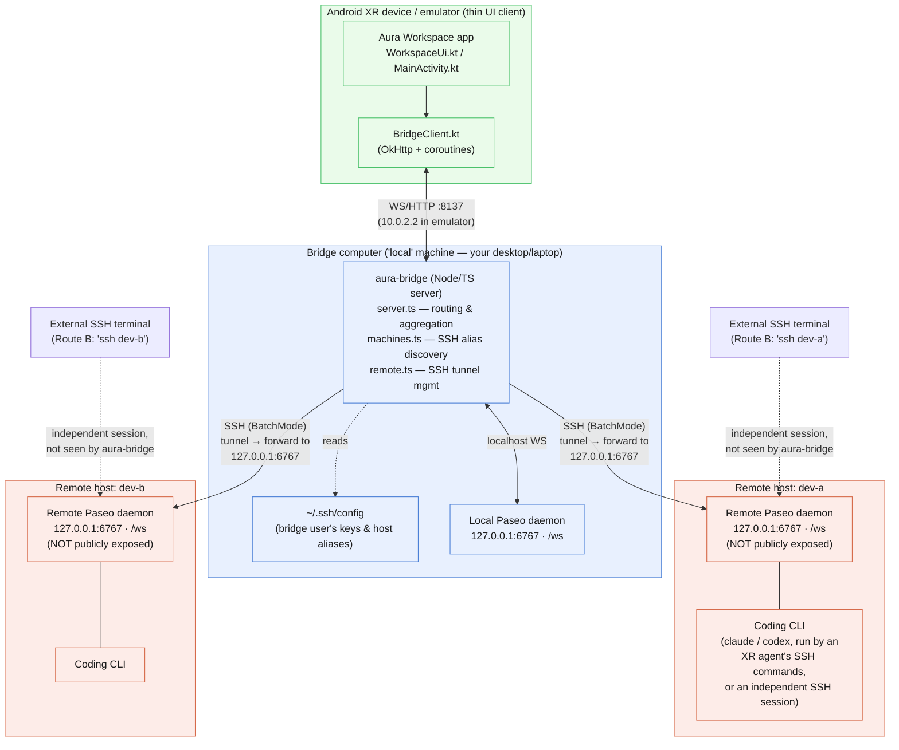

# Architecture: Android XR client, aura-bridge, and Paseo

Companion to [Try Aura Workspace](try-it-workflows.md) and [Remote setup and current limits](remote-setup-and-limits.md).

The Android XR client never talks to any Paseo daemon directly. It only
connects to `aura-bridge`, which runs on the "bridge computer" (a regular
desktop/laptop, not the glasses/headset) alongside a local Paseo daemon.
`aura-bridge` holds the bridge user's SSH keys/config and is the only
process that opens SSH tunnels to remote hosts, forwarding to each remote
Paseo daemon's loopback port (`127.0.0.1:6767`). Remote Paseo daemons are
never exposed publicly — the SSH tunnel is the only path to them.

## Key points

- **One hop for the client**: the app/glasses only ever speaks to
  `aura-bridge`, never directly to any Paseo daemon.
- **`aura-bridge` is the only process holding SSH credentials** — that's
  why it lives on a desktop, not the headset.
- **Remote Paseo daemons stay on loopback** (`127.0.0.1:6767`) on their own
  hosts; they're reachable only via the SSH tunnel `aura-bridge` opens,
  never exposed publicly.
- **Route B** (dotted lines) — an independent `ssh dev-a`/`dev-b` session
  with a CLI running directly — talks to the same remote Paseo daemon but
  completely outside `aura-bridge`'s awareness, which is why those sessions
  don't show up as XR agent cards.

## Implementation references

- [Workspace UI labels and fields](../client-android/app/src/main/java/dev/aura/xr/ui/WorkspaceUi.kt)
- [Navigation, local agent targeting, voice creation, and launch layout](../client-android/app/src/main/java/dev/aura/xr/MainActivity.kt)
- [Client file roots and terminal machine selection](../client-android/app/src/main/java/dev/aura/xr/net/BridgeClient.kt)
- [SSH alias discovery](../aura-bridge/src/machines.ts)
- [Remote Paseo tunnel](../aura-bridge/src/remote.ts)
- [Bridge routing and local-only agent handlers](../aura-bridge/src/server.ts)
