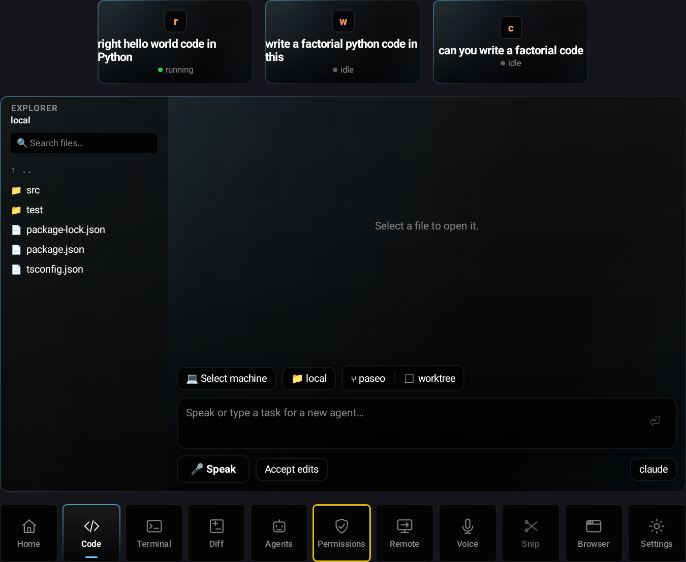

# Try LensCode: remote projects and AI coding

These walkthroughs match the Android XR controls in this repository as of September 7, 2026. They are based on the implementation; the full two-machine workflow has not been exercised against two live remote hosts.

In the tablet emulator, click the labels below. On XR hardware, select the same controls. The agent cards appear above the main screen. The dock below it reads **Code → Terminal → Diff → Git → Agents → Permissions → Remote → Voice**.

## Before you start

1. Complete [remote setup](remote-setup-and-limits.md#prepare-two-machines).
2. Launch LensCode. Confirm that the main screen says **bridge connected** and **paseo connected**.
3. Use two SSH aliases, such as `dev-a` and `dev-b`. Replace the example user `alex` and all example paths with your actual remote paths.
4. Start with a disposable demo folder. You will create files during these exercises.

### Choose how you want to run AI

| Route | Where you give instructions | Where the AI runs | Where code changes happen |
| --- | --- | --- | --- |
| A: XR agent using SSH | **Agents → agent card → Send a message… → Send** | Local Paseo machine | Remote machine, if the agent follows your explicit SSH instruction |
| B: AI installed remotely | An SSH terminal outside XR | Remote machine | Remote machine |

Route A is the closest to an entirely XR workflow today. It requires an existing local Paseo agent with permission and tooling to run SSH. Route B lets you use independent AI sessions on both remote machines, but those sessions do **not** become XR agent cards automatically.

**Selecting a remote folder does not retarget the Agents or Voice AI controls to that machine.** Always state the SSH alias and absolute project path when using Route A. The current **Open Workspace** action on an agent card opens a local workspace; use **Remote → Browse** for remote code.

## 1. Connect to a remote machine and open a folder

1. Click **Remote** in the bottom dock.
2. Find `dev-a` and click **Connect** on its row.
3. Wait for **Open folder on dev-a**. On the first connection, browsing starts at the remote home directory.
4. Click a folder name to enter it. Click **↑ ..** to go up a directory.
5. Navigate to the project folder you want. Check the displayed absolute path.
6. Click **Open this folder**.
7. The app switches to **Code**. The explorer heading includes the machine label and folder name. Click a file in the left explorer to read it.
8. To inspect remote terminals, click **Remote → Terminals** on the `dev-a` row, then click a terminal in the left list.

Expected result: Code shows files from `dev-a`. The Terminal heading shows its remote machine ID. Opening a folder also requests a new terminal rooted in that directory. Explicitly use **Remote → Terminals** when checking which machine's terminals you are viewing.

If already connected, use **Browse** instead of **Connect**. Browse starts at `/`, so you may need to enter `home → alex → projects` on Linux or `Users → alex → projects` on macOS.

## 2. Create a new remote project and ask AI to write it from scratch

### Route A: send the task through an XR agent

1. Click **Agents**, then click an existing, non-closed agent. You can also click its card above the main screen.
2. In **Send a message…**, enter the prompt below with your real alias and path. You can use the small microphone beside the message field to dictate it, then review the text.
3. Click **Send**.

> Use SSH alias dev-a for every project command. The project must exist only at /home/alex/projects/lenscode-notes-demo on dev-a, not on the local machine. First verify the remote hostname and report the absolute target path. If that directory already contains files, stop and ask me before changing them. Create a small notes app from scratch using index.html, styles.css, and app.js, with no build tools or external dependencies. Include adding and deleting notes, localStorage persistence, keyboard-accessible controls, and a README with run instructions. Use a dark glass visual style with subtly rounded rectangular cards. Initialize Git if this is a new directory. Check the JavaScript syntax and report exactly which checks passed. Do not commit or deploy anything.

4. Reopen the agent card to inspect **ACTIVITY**. A successful Send closes the detail card.
5. If the agent is waiting for approval, click **Permissions**, read the requested action, then click **Allow** or **Deny**. Return to the agent card afterward.
6. Wait until the agent reports the files were created on `dev-a`. An **idle** state alone is not proof the task succeeded; read its response.
7. Click **Remote → Connect** for `dev-a`, or **Browse** if already connected.
8. Enter `home → alex → projects → lenscode-notes-demo`, then click **Open this folder**.
9. In **Code**, click `index.html`, `styles.css`, `app.js`, and `README.md` to inspect the output.

Expected result: the files exist on the specified remote host and are readable in XR. The Code panel is a source viewer, not a running web preview.

### Route B: run the AI directly on the remote machine

1. On your computer, open an external terminal and connect:

   ```sh
   ssh dev-a
   mkdir -p /home/alex/projects/lenscode-notes-demo
   cd /home/alex/projects/lenscode-notes-demo
   pwd
   ls -la
   ```

2. If the directory is not empty, choose another demo directory. Otherwise, start your installed, authenticated coding CLI there—for example `claude` or `codex`, if that command is available on this machine.
3. Ask it to build the notes app described above. For this route, say “work in this directory”; no nested SSH instruction is needed.
4. Keep that terminal open to read replies and answer that CLI's permission prompts.
5. In XR, follow steps 7–9 of Route A to inspect the generated code.

The XR **Terminal** currently displays output but has no command-entry field. Type these shell commands in your external SSH terminal. An arbitrary SSH shell or coding CLI is not automatically registered as a Paseo terminal or XR agent.

## 3. Open an existing remote project and ask AI to change something

1. Click **Remote → Browse** on `dev-b` (or **Connect** first).
2. Navigate to an existing repository, for example `/home/alex/projects/existing-site`.
3. Click **Open this folder**.
4. Click **Code**, open the relevant file, and inspect the current behavior's implementation.
5. Click **Git** to inspect the current branch. Check **Diff** for changes already present before starting your task.
6. Open a local agent from **Agents**, fill **Send a message…**, and click **Send**:

> Work through SSH alias dev-b in /home/alex/projects/existing-site. First report the remote hostname, absolute working directory, current Git branch, and existing uncommitted changes. Preserve those changes. Find the site's header and add a light/dark theme toggle that remembers its setting. Follow the existing framework and styling conventions. Make the toggle keyboard accessible. Run the project's relevant existing checks. Tell me which files changed and how to try the feature. Do not commit or deploy.

7. Watch **ACTIVITY** and answer relevant requests in **Permissions**.
8. When complete, return to **Remote → dev-b → Browse → project folder → Open this folder**. This also reloads the directory listing.
9. Click the changed files in **Code** to fetch their current contents.
10. Click **Diff**, then click a changed file in its left list to inspect additions and deletions.

For an AI running directly on `dev-b`, send the same task in its external SSH session, omitting the SSH instruction. Its approvals belong in that session, not the XR Permissions queue.

## 4. Switch between two remote projects and see their code

1. Connect both `dev-a` and `dev-b` through **Remote**.
2. On `dev-a`, click **Browse**, navigate to `lenscode-notes-demo`, then click **Open this folder**.
3. Open `app.js` in **Code**. Confirm the explorer heading identifies `dev-a` and the expected folder.
4. Click **Remote**, then **Browse** on `dev-b`.
5. Navigate to `existing-site`, click **Open this folder**, and inspect its changed header file.
6. Repeat the same Browse/Open sequence to return to `dev-a`.
7. For terminal output, use **Remote → Terminals** on the desired machine, then select a terminal by its title and working directory.

Code shows one project's files at a time. There is no two-project tab bar or side-by-side code comparison yet. Changing the terminal machine alone does not change the Code root; use Browse/Open for code.

## 5. Switch between AI conversations

### Agents already listed inside XR

1. Click **Agents** to see the local Paseo agents.
2. Click the first agent and read its label, provider, working directory, and **ACTIVITY**.
3. Send a follow-up, such as: “On dev-a, in /home/alex/projects/lenscode-notes-demo, add a search field for notes. Preserve the existing implementation and run the relevant checks.”
4. Click another agent card, or **Close** and select another agent from **Agents**.
5. Send its task with `dev-b` and the absolute directory explicitly named.
6. Use **Remote → Browse → Open this folder** to inspect the output from each machine.

This switches between local AI conversations that may operate over SSH. It does not switch the underlying agent runtime to another host. If you have only one listed agent, you can use it for both tasks sequentially, with the host and path stated each time.

### Independent AI sessions running on both remote machines

1. Open two external terminal tabs: `ssh dev-a` in the first, `ssh dev-b` in the second.
2. In each tab, enter its project directory and start the coding CLI installed there.
3. Give each AI a different task and keep the tabs open for replies and approvals.
4. Switch terminal tabs to talk to the corresponding AI.
5. Switch remote folders inside XR as in exercise 4 to read their code.

**Not available yet:** selecting native remote AI sessions from XR agent cards, a machine selector for agent creation, and a unified remote-agent Permissions queue.

## 6. Try Voice without confusing navigation and AI prompts



*The Code view's composer: dictate a task with **Speak**, review the transcript
in the field, then send it — the spoken text never dispatches on its own.*

1. Click **Voice** in the dock.
2. Say “open code” or “open remote.”
3. Check the **Did I get that right?** transcript and click **Submit**. Click **Cancel** if it is wrong.
4. To message a specific existing agent, open its card and use the small microphone next to **Send a message…** instead. Review the field, then click **Send**.

Creating an agent from a spoken coding task requires the Gemini/Koog voice router to be configured in the APK. Without it, the fallback handles navigation and file search, not arbitrary coding tasks. There is no clickable **New Agent** form today. The voice creation path uses local Claude with `cwd = "."` and may reuse a previous voice agent. It does not inherit the remote folder you are viewing. See the [limitations](remote-setup-and-limits.md#current-limits-that-affect-these-exercises) before using it to start a new task.

## What to check after each exercise

- The machine alias and absolute project path match the task you intended.
- The expected files appear in Code after reopening the folder or file.
- The agent reports checks it actually ran; inspect its activity and errors.
- Existing edits remain intact.
- Switching projects changes the explorer heading and file list to the intended host.
- Restarting the app restores the centered main panel, agents above it, and dock below it.

For troubleshooting and implementation references, see [remote setup and current limits](remote-setup-and-limits.md).
